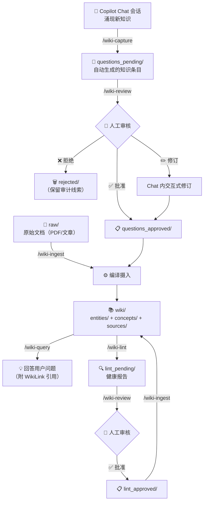

# awesome-copilot-x

> GitHub Copilot 自定义扩展集合 — Skills、Agents、Instructions、Hooks。

## 安装

```bash
# Clone 到本地
git clone <repo-url> awesome-copilot-x

# 配置环境变量（指向 llm-wiki 数据仓库）
export LLM_WIKI_PATH=/path/to/llm-wiki
```

## Plugins 目录结构

```
plugins/
├── skills/                     # Copilot Skills（自定义斜杠命令）
│   ├── wiki-ingest/SKILL.md    # 文档摄入
│   ├── wiki-query/SKILL.md     # 知识查询
│   ├── wiki-lint/SKILL.md      # 健康检查
│   ├── wiki-sync/SKILL.md      # 增量同步
│   ├── wiki-capture/SKILL.md   # 会话知识捕获
│   ├── wiki-review/SKILL.md    # 人工审核
│   └── wiki-bootstrap/SKILL.md # 冷启动引导
├── agents/                     # Copilot Agents（统一 @wiki agent）
│   └── wiki.agent.md
└── instructions/               # Copilot Instructions（共享规则）
    ├── llm-wiki-schema.instructions.md  # Wiki 页面格式规范
    └── wiki-context.instructions.md     # 跨会话上下文感知
```

## 完整流水线

LLM Wiki 采用 **Human-Gated Compounding Loop**（人机审核循环）：自动生成的内容永远先进入 `*_pending/` 等待人工审核，确认后才编译为正式 Wiki 页面。



> **核心原则**：人工审核不可跳过。自动生成的内容永远先进入 `*_pending/`，必须经人类确认才能进入 Wiki。去重时遵循「宁多勿少」—— 不确定是否重复就创建新页面，合并错误的代价远大于合并重复。

## 设计原则（LLM 消费导向）

Wiki 的消费方是 **LLM agent**（按需检索进有限上下文窗口），而非人类读者。因此：

- **粒度**：概念独立成页须满足三条件——有独立检索价值 + 自包含 + 是知识非数据；无独立检索价值的子流程并入父页（`#锚点`）。粒度「自包含优先，允许原子化，杜绝重复与低信号」与去重「宁多勿少」是相反策略，勿混用。
- **页面硬标准**：每页自包含（单独拉取可完整理解）+ ≤300 行/约 4KB + 页末细节指针（progressive disclosure → 原始文档/上游）。
- **索引**：source 页必含「知识地图」（文档级 llms.txt，小而高信号）；`wiki/index.md` 为全库 llms.txt（llms.txt 标准行格式 `- [标题](路径): 描述`，小而分层，超窗口拆主题级 MOC）。
- **synthesis**：跨文档主题综合（draft → `/wiki-review` 人工批准），不复述单文档。

## LLM Wiki Skills 速览

| 分类 | 命令 | 功能 | 输入 → 输出 | 适用范围 |
|------|------|------|------------|----------|
| 核心 | `/wiki-capture` | 从 Chat 会话提取结构化知识 | Chat 会话 → `questions_pending/` | **任意**工作区 |
| 核心 | `/wiki-review` | 人工审核 pending 条目（all/batch/slug/merge 模式），含质量门、synthesis 批准、存量碎片页合并 | `questions_pending/` → `questions_approved/` 或 `rejected/` | `$LLM_WIKI_PATH` 工作区 |
| 核心 | `/wiki-ingest` | 编译摄入已批准的知识和原始文档（知识地图 + 自包含/大小上限/细节指针） | `questions_approved/` + `raw/` → `wiki/` | `$LLM_WIKI_PATH` 工作区 |
| 核心 | `/wiki-query` | 查询 Wiki 知识库（知识地图导航 + 细节指针跟随；大库 BM25 预筛脚本），返回带 [[WikiLink]] 引用的综合回答 | 用户问题 → 带引用的答案 | `$LLM_WIKI_PATH` 工作区 |
| 核心 | `/wiki-lint` | 健康检查：矛盾、孤立页、过期内容、格式违规 + LLM 消费质量检查（大小上限/知识地图/细节指针/index） | `wiki/` → `lint_pending/` | `$LLM_WIKI_PATH` 工作区 |
| 辅助 | `/wiki-sync` | 直接提交并推送到 origin/main（单人简化，无分支/checkpoint 机制） | 本地变更 → 远程仓库 | `$LLM_WIKI_PATH` 工作区 |
| 辅助 | `/wiki-bootstrap` | 从 GitHub 仓库冷启动构建 Wiki | GitHub 仓库 → 初始 Wiki 页面 | `$LLM_WIKI_PATH` 工作区 |

## Agent 配置

统一的 `@wiki` Agent 按用户意图路由到对应 Skill 工作流，在 Copilot Chat 中通过 `@wiki` 调用：

| Agent | 覆盖 Skill | 可用工具 |
|-------|-----------|----------|
| `@wiki` | `/wiki-capture`、`/wiki-review`、`/wiki-ingest`、`/wiki-query`、`/wiki-lint`、`/wiki-sync`、`/wiki-bootstrap` | read_file, create_file, replace_string_in_file, list_dir, run_in_terminal, grep_search |

## Instruction 说明

| Instruction | applyTo | 作用 |
|-------------|---------|------|
| `llm-wiki-schema.instructions.md` | `**/wiki/**/*.md` | 所有 Wiki 页面必须遵循的 frontmatter 规范 |
| `wiki-context.instructions.md` | `**` | Wiki 定位指针 + 状态按需从事实源派生（log.md / questions_pending/） |

## 环境变量

| 变量 | 必填 | 说明 |
|------|------|------|
| `$LLM_WIKI_PATH` | ✓ | 指向 `llm-wiki` 数据仓库的绝对路径 |

## 相关仓库

- [llm-wiki](https://github.com/arawlin/llm-wiki) — Wiki 数据仓库
- [docs](https://github.com/arawlin/docs) — 方案讨论、Spike 研究、实现计划
