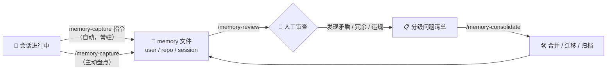

# Memory — VS Code Memory 管理插件

> VS Code memory tool（`/memories/`）的提取、审查、整合三件套。命名统一 `memory-*` 前缀，作为自包含插件与 `llm-wiki` 平级。

## 插件结构

```
plugins/memory/
├── README.md
├── instructions/
│   └── memory-capture.instructions.md   # 提取准则（常驻规则）
└── skills/
    ├── memory-capture/SKILL.md          # 主动提取（盘点会话/批量）
    ├── memory-review/SKILL.md           # 审查：冗余 / 矛盾 / 合规
    └── memory-consolidate/SKILL.md      # 整合：合并 / 迁移 / 归档
```

## 工作流

Memory 生命周期采用「常驻提取 → 人工审查 → 执行整合」三步循环：



## Skills 速览

| 命令 | 功能 | 输入 → 输出 | 适用范围 |
|------|------|------------|----------|
| `/memory-capture` | 主动盘点会话（或指定范围），按规则提取并写入正确主题文件（过滤 → scope → 文件归属 → 查重，人确认） | 会话 → memory 文件 | 任意工作区 |
| `/memory-review` | 三查：冗余 / 矛盾 / 最佳实践合规，产出分级问题清单（🔴🟡🟢）供人裁决 | memory 文件 → 修复清单 | 任意工作区 |
| `/memory-consolidate` | 执行修复：合并同主题文件、迁移 scope、归档过期条目、拆分超限文件 | 问题清单 → 整洁 memory | 任意工作区 |

## Instruction 说明

| Instruction | applyTo | 作用 |
|-------------|---------|------|
| `memory-capture.instructions.md` | `**` | 会话中自动提取可复用知识到 memory：三档 scope 选择、触发信号、分层过滤标准（user 档从严 + 默认降级 + 人工确认门）、上限 8 条/会话、单行格式与去重 |

## 与其他插件的关系

- **llm-wiki**：wiki 是「人工审核的知识库」（`questions_pending/` 状态机）；memory 是「agent 上下文记忆」。`wiki-review` 是 `memory-review` 的参考模板。
- **memory-management**（外部 SEO/GEO 插件）：管理 SEO 项目三 tier 记忆（HOT/WARM/COLD），与 VS Code memory tool 无关，职责不同，勿混用。

## 作者维护约定

- **单一事实源**：skill 不复制 `memory-capture.instructions.md` 的规则内容——按名字引用（该指令为 applyTo '**' 全局注册），规则变更自动跟随。
- **不用相对路径引用全局指令**：skill 安装到用户级（如 `~/.agents/skills/`）后相对路径会漂移——相对路径 Markdown 链接只用于 skill 目录内资源。
- **Gotchas 只写执行层**：Gotchas 面向执行 skill 的 agent，只放操作级警告（如跳过查重、省略 Source）；作者层规范放本节，不占用执行上下文。
